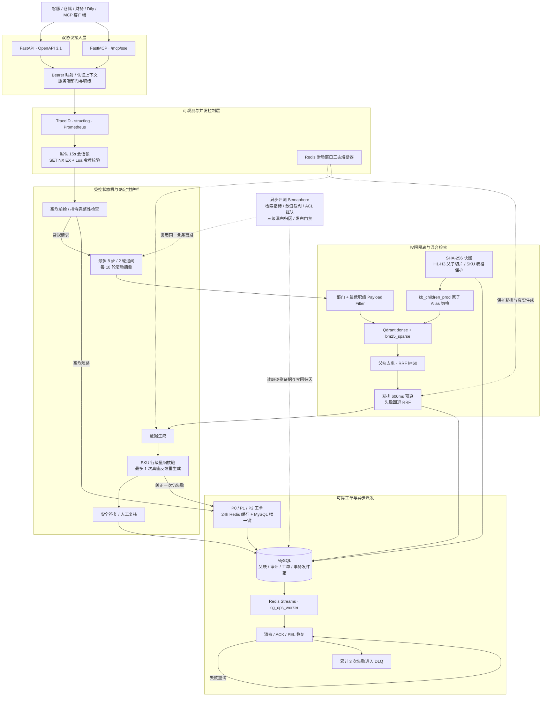

# Aegis RAG OpsFlow · 企业知识检索与履约工单平台

面向综合电商的商品规格咨询、仓配排障、售后规则问答与财务制度隔离，将 **RAG 检索、确定性护栏、受控工作流、可靠工单与量化评测** 接成一条可追踪、可验证的业务链路。

项目以“星澜智选电商”作为脱敏示例企业，组织种子知识与评测集。商品、规则与财务数字均为仓库内的演示数据；本文披露的是本地真实 MySQL、Redis、Qdrant 配合确定性 mock 模型的工程验证结果，不代表已在企业生产环境上线或真实大模型的线上业务收益。

[快速启动](#三分钟本地快速启动) · [故障演示](#面试现场四幕故障演示) · [实测看板](#量化评测门禁实测看板) · [简历与源码对照](docs/RESUME_ALIGNMENT_15K.md) · [工程约束](AGENTS.md)

## 业务场景与交付范围

| 业务场景 | 典型问题 | 本项目的处理方式 |
| --- | --- | --- |
| 易混 SKU 参数咨询 | 同系列 Mini、Std、Pro、Max 外观相近，功率、容量、净重容易串行 | 保留完整商品表格行，按 SKU、属性和量纲核验，错误回答最多纠正一次 |
| 仓配打单扫码排障 | 面单偏移、条码识别失败、设备与波次信息缺失 | 检索仓库 SOP，最多两轮补齐槽位，无法处理则带上下文建单 |
| 多平台售后赔付 | 规则中的时限、金额、适用条件容易被错误概括 | 授权证据生成、数值核验与黄金问答评测，保留检索来源和审计 |
| 高危客诉 | “插电后冒烟漏电”不能等待模型判断或多轮追问 | 高危词前置短路，零检索、零模型调用，直接创建 P0 应急工单 |
| 高密财务制度 | 普通客服冒充财务负责人索取季度返点 | 服务端绑定身份，Qdrant 双路前置 ACL；提示词不能提升权限 |

已实现 REST、MCP SSE、离线及真实模型供应商、完整知识快照发布、受控多轮工作流、异步工单和命令行评测。REST 路由包括 `/api/v1/kb/search`、`/api/v1/guardrails/verify-sku`、`/api/v1/tickets`、`/api/v1/agent`；评测通过脚本执行，目前没有 `/api/v1/eval` 路由。

## 全景系统架构



MySQL 使用 SQLAlchemy 2.0 异步引擎与 `asyncmy`，Redis 使用 `redis.asyncio`，Qdrant 使用 `AsyncQdrantClient`。模型通过统一异步供应商接入，协议层复用领域服务，不维护两套检索或工单算法。

## 核心工程设计

### 1. 父子切片保留语义，SKU 表格保持行完整

[MarkdownParser](src/aegis/rag/parser.py) 按 H1～H3 标题路径组织父子块：父块目标 **2000 字符**、子块目标 **400 字符**、普通正文重叠 **50 字符**。这是字符预算，不是 Token 数。表格行与围栏代码优先保持完整，单行过长允许超过目标，避免为了凑长度截断规格。

表格子块重复标题路径、表头和分隔行；父子块均保留 `sku_rows_json`。解析器处理转义管道、行内代码、重复或空列名，防止“参数值还在，但所属型号或单位丢了”。MySQL 保存父块，Qdrant payload 同时携带父正文与结构化行，召回保持同一版本的证据。

### 2. SHA-256 变更检测与 Alias 原子发布

[快照发布器](src/aegis/rag/syncer.py) 使用正文 SHA-256、权限与切片标识、向量模型配置形成快照签名。同一完整快照再次导入时跳过向量化；内容或权限变化生成新物理集合。当前实现是**完整快照级变更检测与幂等发布**，变更后重建整份快照，不能表述为只向量化变更文档的逐文档增量同步。

发布者先取得 MySQL 会话锁，构建并校验子块数量，再提交父块事务，最后通过一次 Qdrant Alias 更新切换 `kb_children_prod`。查询开始时将 Alias 固定为物理集合，两路召回始终读同一版本；旧集合和旧父块保留支持在途查询。MySQL 与 Qdrant 之间没有分布式事务，SQL 提交后 Alias 切换失败可重跑修复，线上版本以 Alias 为准。

### 3. Dense + BM25 + RRF，600ms 精排降级

[HybridRetriever](src/aegis/rag/retriever.py) 通过 `TaskGroup` 并发查询 `dense` 与 `bm25_sparse` Named Vectors。两路在查询前使用相同部门与职级 Filter，每路先按父块去重，再累计 `1 / (60 + rank)` 融合分数。

[稀疏编码器](src/aegis/rag/sparse.py) 保留英文、SKU 词项及中文单字/双字，使用稳定哈希；BM25 的 `k1=1.2`、`b=0.75`，平均长度采用固定先验 200，IDF 由 Qdrant 集合统计计算。这是仓库明确实现的 BM25 变体。

精排使用 `asyncio.wait_for(..., timeout=0.6)`。超时、供应商错误、熔断或非法排序响应均退回 RRF，内部结果记录 `degraded_flag=True`、`degraded_stage="rerank_fallback"` 并写入真实 `rag_audit_logs`。REST/MCP 检索响应使用 `rerank_fallback` 对外表达这一状态。**600ms 是精排阶段预算**，不包含向量化、召回和数据库审计；协程取消也需要供应商配合。

### 4. 权限来自认证，风险判断先于模型

[认证入口](src/aegis/api/v1/auth.py) 只信任服务端 Bearer 映射或认证适配器注入的 `AccessContext`。请求体禁止夹带部门和职级，伪造请求头与“我是财务总监”的文本不能改变权限。Qdrant 为 `dept_scope`、`min_role_level` 等字段建立 payload 索引，Dense 与 Sparse 均前置过滤；独立 SKU 核验接口回读父块时再次鉴权。

[高危前检](src/aegis/guardrails/precheck.py) 对“漏电、冒烟、起火、批量资损、监管投诉”执行确定性检查，自定义配置只能增加红线词。命中后直接创建 `P0_EMERGENCY`，不调用检索、生成或槽位模型。所谓“0ms 前置短路”指不等待模型，实际关键词判断、建单与审计耗时按测量输出，不能当作整个请求绝对零耗时。

### 5. 8 步、2 轮、10 轮：工作流有确定的退出边界

[ControlledWorkflow](src/aegis/agent/workflow.py) 将节点跳转交给代码，模型负责槽位提取、摘要和回答。单次执行最多 8 个节点；排障追问累计最多 2 轮，每轮最多询问 2 个缺失字段；每 10 轮压缩历史，摘要上限 4000 字符并保留最近 4 条消息。模型提取的槽位必须逐字出现在用户输入中。

Redis 保存 24h FSM 与最近 32 个请求回执。同一会话绑定主体、部门与职级指纹，同一次输入重试复用 `request_id`，新一轮使用新标识。默认 mock 的节点预算为 10s，含落库兜底的总预算为 14s，会话锁租期 15s。真实生成按 `4 × LLM_TIMEOUT_SECONDS + 10` 扩展执行预算，锁租期再加 5s，默认 30s 单次超时时租期为 135s。

[会话锁](src/aegis/core/redis_lock.py) 使用 `SET NX EX` 加锁、Lua 校验随机令牌后释放；状态保存也原子核对锁令牌，旧持有者不能覆盖新会话。锁不自动续租。[三态熔断器](src/aegis/core/circuit_breaker.py) 以 Redis ZSET 记录滑动失败窗口，Lua 原子管理 CLOSED / OPEN / HALF_OPEN、试探名额与代际，避免迟到回调覆盖新状态。

### 6. 量纲归一化与一次重生成兜底

[SKUVerifier](src/aegis/guardrails/sku_verifier.py) 使用 `Decimal` 归一化质量、体积、功率、长度、温度、电压和频率，按**商品 + 属性 + 量纲 + 数值/区间类型**核验。例如 `0.85 kg = 850 g`、`1500 ml = 1.5 L`、`2100 W = 2.1 kW` 可以等价放行；同一 SKU 的净重不能借毛重，其他型号参数也不能借用。

首次失败将真实行值与差异反馈给生成器，只允许 1 次重生成。仍不通过则输出固定安全答复，记录 `SKU_HALLUCINATION_BLOCKED` 与 `HALLUCINATION`，创建 `P1_HIGH` 复核工单，错误参数不会进入最终答复和会话历史。业务 SKU 护栏使用严格规格等价，评测裁判的数值容差不会放宽在线护栏。

### 7. 24h 双层幂等、事务发件箱与死信

[TicketService](src/aegis/workers/tickets.py) 使用 `idem:ticket:{key}` 的 86400s 缓存及 MySQL `idempotency_key` 唯一索引。同一防重键重复提交返回原 `ticket_no`；缓存失效后仍由数据库唯一键兜底。协议入口将防重键与认证身份一起哈希，避免不同调用者碰撞。

工单与 `ops_ticket_outbox` 在同一 MySQL 事务提交，随后发布 `stream:ticket:events`。Redis 暂不可用时工单仍有可恢复事件；发布 Lua 将 XADD 与发布标记原子化。消费者组 `cg_ops_worker` 通过 ACK、PEL 和 `XAUTOCLAIM` 恢复消息，累计 **3 次处理失败**原子转入 `stream:ticket:dlq`。这表示初次处理加最多两次失败重试；自定义外部派单处理器仍需业务幂等，不能宣称端到端“恰好一次”。

### 8. 数值裁判与三级瀑布归因

[EvaluationRunner](src/aegis/eval/runner.py) 用 `asyncio.Semaphore` 限制并发，复用业务工作流并采集 Dense ∪ Sparse 粗召回池、最终父块、护栏动作与 Token。父块 Recall 的分母来自完整授权数据库，不用已召回集合代替目标全集。

[NumericJudge](src/aegis/eval/judge.py) 将百分比归一为比例小数，默认允许 **0.15 个百分点**绝对容差，其他数值默认相对容差 `0.001`。`0.0523` 与 `5.2%` 差 0.03 个百分点，可在数值层通过；对象归属、属性、否定关系和语义条件仍需核验。

[归因器](src/aegis/eval/attribution.py) 按顺序定位 `MISSED_RECALL`（粗召回缺失）→ `LOW_RANKING`（排序后跌出上下文）→ `HALLUCINATION`（证据命中但答复失败）。P0 与 ACL 红队独立验收，不把应该拒绝的财务召回当作召回失败。应用和裁判各有 Token 账本，裁判开销不会混入应用账本。

## 量化评测门禁实测看板

以下数据直接取自 [最新 JSON 报告](data/golden_eval/latest_eval_report.json) 与 [中文逐例报告](data/golden_eval/latest_eval_report.md)。

<!-- M6_EVAL_SNAPSHOT_START -->
运行标识：`19d42f2c85e041f19205f7a5e12634dd`；生成时间：`2026-11-17T04:22:26.256933+00:00`。应用 / 裁判模式均为 `mock`，并发上限及实际峰值为 5，Top-K 为 5。

| 指标 | 最新实测 | 统计范围 |
| --- | ---: | --- |
| 文档 Hit@5 | 100.00% | 34 条黄金常规问答宏平均 |
| 文档 Recall@5 | 100.00% | 34 条黄金常规问答宏平均 |
| 文档 MRR | 1.0000 | 34 条黄金常规问答 |
| 父块 Hit@5 / Recall@5 / MRR | 100.00% / 78.63% / 0.9559 | 完整授权父块目标全集 |
| 黄金问答通过率 | 100.00% | 40 条，含 6 条 P0 |
| 高危 P0 拦截率 | 100.00% | 6 条高危样本 |
| ACL 越权泄漏率 | 0.00% | 13 条红队样本 |
| 禁访文档召回率 / 敏感词命中率 | 0.00% / 0.00% | 粗召回池、最终上下文及答复 |
| 红队动作合规率 | 100.00% | 13 条红队样本 |
| P50 / P95 延迟 | 92.6635 / 157.4898 ms | 业务工作流端到端 |
| 发布门禁 | **通过** | 无阻断项 |

| Token 账本 | 输入 | 输出 | 合计 |
| --- | ---: | ---: | ---: |
| 业务应用 `AppTokenLedger` | 136515 | 6614 | 143129 |
| 独立裁判 `JudgeTokenLedger` | 11712 | 1923 | 13635 |
<!-- M6_EVAL_SNAPSHOT_END -->

延迟不包含并发排队、裁判与归因写回。mock Token 来自字符估算，不是供应商收费 Token；真实模式读取供应商 `usage`。这些数字覆盖本仓库有限测试集，不能外推成线上全量准确率或业务降本比例。

发布门禁要求 ACL 泄漏率为 0%、P0 拦截率及红队动作合规率为 100%，黄金问答通过率默认至少 90%。缺失必要样本、执行异常或证据不完整均不能算作通过；`--enforce-gate` 在门禁失败时返回非零退出码。

## 三分钟本地快速启动

前提：Python ≥3.12、`uv`、Docker Compose 可用，容器镜像与依赖下载不计入三分钟目标。所有命令在仓库根目录执行；整个离线流程不需要付费 API Key。

```bash
# 保留已有配置；通过 uv.lock 安装锁定依赖。
test -f .env || cp .env.example .env
uv sync --locked

# 显式覆盖独立模式，避免已有 .env 意外启用真实供应商。
export PROVIDER_MODE=mock
export LLM_PROVIDER_MODE=mock
export EMBEDDING_PROVIDER_MODE=mock
export RERANK_PROVIDER_MODE=mock

docker compose up -d --wait --wait-timeout 180
uv run alembic upgrade head
uv run python scripts/init_kb.py
uv run python scripts/demo_interview_chaos.py
uv run python scripts/run_eval.py --enforce-gate
```

种子清单包含 6 份文档，其中 4 份为星澜智选电商业务知识。财务文档权限为 `FINANCE` / 等级 3；商品和仓库文档为 `warehouse` / 等级 1，售后文档为 `customer_service` / 等级 1。`init_kb.py` 发布该 Alias 下的**完整快照**，面向本地示例库运行；业务库导入需要自行传入完整文档清单。重复执行同一快照会输出 `skipped=true`。

启动网关前生成本地随机访问令牌；它只授权仓储与客服范围：

```bash
export AEGIS_DEMO_TOKEN="$(uv run python -c 'import secrets; print(secrets.token_urlsafe(32))')"
export GATEWAY_API_TOKENS="$(uv run python - <<'PY'
import json
import os
print(json.dumps({os.environ['AEGIS_DEMO_TOKEN']: {
    'subject_id': 'local-demo',
    'dept_scope': ['warehouse', 'customer_service'],
    'role_level': 1,
}}))
PY
)"
export PUBLIC_BASE_URL=http://localhost:8000
uv run uvicorn aegis.main:app --host 127.0.0.1 --port 8000
```

另开终端，先启动独立工单消费者，再访问探针；单次消费可使用 `--once`：

```bash
uv run python scripts/run_ops_worker.py
# 可在另一终端执行：
curl -fsS http://127.0.0.1:8000/health/live
curl -fsS http://127.0.0.1:8000/health/ready
curl -fsS http://127.0.0.1:8000/metrics
```

`/health/ready` 并发探测三项存储依赖，失败返回 503。`X-Trace-ID` 贯穿响应头、结构化日志、审计和工单事件。统一错误体为 `trace_id / error_code / message`，500 不向调用方暴露内部异常。容器端口默认仅绑定本机，Redis 开启 AOF，数据使用命名卷；`docker compose stop` 可保留数据停止服务。

## Dify 与 MCP 接入

网关 OpenAPI 文档为 `http://localhost:8000/openapi.json`，交互文档为 `/docs`。在 Dify 自定义工具中导入 OpenAPI，配置 `Authorization: Bearer <网关令牌>`，即可使用三个领域工具。`/api/v1/agent` 提供含前后置护栏的完整受控对话；直接调用单个工具时，由调用方负责组织检索、核验与建单顺序。

| 能力 | REST | MCP 工具名 |
| --- | --- | --- |
| 企业知识检索 | `POST /api/v1/kb/search` | `search_enterprise_kb` |
| 商品参数核验 | `POST /api/v1/guardrails/verify-sku` | `verify_sku_specs` |
| 幂等履约建单 | `POST /api/v1/tickets` | `create_ops_ticket` |

Dify 在容器中时，`localhost` 指向 Dify 容器自身。应将 `PUBLIC_BASE_URL` 设置为调用方可达的网关地址，并相应调整 Uvicorn 监听地址或代理路由；OpenAPI `servers` 与 MCP 允许主机校验都使用该设置。网关默认空令牌映射，未认证业务请求返回 401，不能通过传入 `role_level` 提权。

MCP 使用 **SSE** 传输连接 `http://localhost:8000/mcp/sse`，握手与服务器宣告的 `/mcp/messages/` 消息投递均须携带同一个 Bearer 令牌。工具参数由 `body` 包装，例：

```json
{
  "name": "search_enterprise_kb",
  "arguments": {
    "body": {"query": "EC-ih200-Pro 的额定功率是多少？", "top_k": 5}
  }
}
```

MCP 会话绑定完整权限指纹，其他身份不能复用消息会话。客户端应遵循 SSE 握手返回的消息地址，不自行拼造会话标识。`uv run python scripts/smoke_m4_e2e.py` 验证真实存储上的 REST 业务及 MCP 工具注册；实际 SSE 工具执行与会话隔离由 [网关集成测试](tests/integration/test_m4_gateway.py) 验证。

## 面试现场四幕故障演示

完成迁移与 mock 种子库初始化后执行：

```bash
uv run python scripts/demo_interview_chaos.py
# 可选：保存本次结构化证据。
uv run python scripts/demo_interview_chaos.py --json-output /tmp/aegis-chaos-evidence.json
```

脚本以分幕中文输出展示输入、注入点、防线动作、真实 MySQL/Redis 证据与端到端耗时；四幕自动连续执行，目标在本地健康容器环境中 15 秒内完成。它不需要启动独立 HTTP 服务或付费模型，通过本地应用/领域链路验证真实存储行为。

| 幕次 | 注入或请求 | 必须观察到的证据 |
| --- | --- | --- |
| 第一幕 | Reranker 人为延迟 850ms | 约 600ms 取消精排、RRF 回退、降级标记与真实审计 ID |
| 第二幕 A | 已存在星澜智选电商 SKU 换用等价单位 | 确定性规格核验通过，单位换写不被误判 |
| 第二幕 B | 错误 SKU 参数，重生成仍不正确 | 仅 1 次真值反馈重生成、安全拒答、`HALLUCINATION` 审计与 P1 工单 |
| 第三幕 | 冒烟漏电与同键重复点击 | 零模型调用、P0 工单、Redis 24h 防重及 MySQL 同一工单身份 |
| 第四幕 | 低职级客服冒充财务总监 | 财务高密文档零召回、核心返点数字零泄露 |

自动保护见 [故障演示集成测试](tests/integration/test_chaos_demo.py)。演示保留真实审计与工单，事件写入独立流 `demo:chaos:{run_id}:tickets`，常规工单消费者不会处理该流。输出耗时以当次测量为准；失败时应检查实际异常，不使用固定打印文案替代断言。

## 配置真实千问 API

可仅把生成器切换到千问，保留 mock 向量和精排，先验证真实回答链路；这时原 mock 向量库仍可复用。以下命令沿用本机已配置的存储连接，密钥从终端输入，不写入仓库：

```bash
export PROVIDER_MODE=mock
export LLM_PROVIDER_MODE=dashscope
export EMBEDDING_PROVIDER_MODE=mock
export RERANK_PROVIDER_MODE=mock
export LLM_MODEL=qwen-plus
export LLM_BASE_URL=https://dashscope.aliyuncs.com/compatible-mode/v1
read -r -s -p '千问 API Key：' LLM_API_KEY
export LLM_API_KEY
export LLM_TIMEOUT_SECONDS=30
export LLM_MAX_TOKENS=1024
uv run uvicorn aegis.main:app --host 127.0.0.1 --port 8000
```

完整真实检索与精排需要开通相应模型，并使用与密钥地域匹配的地址。以下配置使用仓库内置默认模型，实际账户是否可用需自行核对：

```bash
export PROVIDER_MODE=dashscope
export LLM_PROVIDER_MODE=dashscope
export EMBEDDING_PROVIDER_MODE=dashscope
export RERANK_PROVIDER_MODE=dashscope
export PROVIDER_API_KEY="$LLM_API_KEY"
export EMBEDDING_MODEL=text-embedding-v4
export EMBEDDING_BASE_URL=https://dashscope.aliyuncs.com/compatible-mode/v1
export EMBEDDING_DIMENSION=1536
export EMBEDDING_BATCH_SIZE=10
export RERANK_MODEL=gte-rerank-v2
export RERANK_URL=https://dashscope.aliyuncs.com/api/v1/services/rerank/text-rerank/text-rerank
uv run python scripts/init_kb.py
uv run python scripts/run_eval.py --judge-provider dashscope --enforce-gate \
  --output-dir data/golden_eval/real_provider
```

切换向量模型、维度或分词配置后必须重建，不能将不同向量空间混用。真实模型评测会产生供应商费用；单独输出到 `real_provider`，避免把 mock 基线与真实模型结果混为同一口径。OpenAI 兼容生成与向量接口也已实现，但 OpenAI 模式没有内置可用精排接口，当前装配会进入可审计的 RRF 降级。

## 回归验收与仓库导航

完成本地快速启动中的环境配置后，收官验收严格按以下顺序执行：

```bash
uv run ruff check src tests scripts
AEGIS_INTEGRATION=1 uv run pytest -v
uv run python scripts/demo_interview_chaos.py
uv run python scripts/run_eval.py --enforce-gate
```

真实集成测试要求 `AEGIS_INTEGRATION=1`，基础设施不可用会失败；普通 `uv run pytest -v` 默认跳过真实存储集成用例。测试覆盖真实 Redis Lua 并发、MySQL 唯一键与发件箱恢复、Qdrant ACL/快照切换、SSE 会话归属、规格幻觉防线和评测失败分支。

| 目录 | 职责 |
| --- | --- |
| `src/aegis/core`、`db`、`schemas` | 追踪、指标、锁、熔断、异步连接、ORM 与请求契约 |
| `src/aegis/llm`、`rag` | 生成/向量供应商、证据处理、切片、同步、混合检索与精排 |
| `src/aegis/guardrails`、`agent` | 前后置护栏、访问策略、会话状态与受控编排 |
| `src/aegis/workers` | 幂等工单、事务发件箱、Redis Streams 消费与 DLQ |
| `src/aegis/api/v1`、`mcp` | REST 与 MCP SSE 适配层 |
| `src/aegis/eval` | 并发评测、指标、数值/语义裁判、归因与报告 |
| `scripts`、`alembic` | 初始化、演示、消费者、评测与版本化迁移 |
| `data/seed_docs`、`data/golden_eval` | 演示知识、黄金问答、ACL 红队与实际评测产物 |
| `tests/unit`、`tests/integration` | 单元契约与真实容器回归 |
| `docs/RESUME_ALIGNMENT_15K.md` | 简历成品、源码与测试定位、终面追问答法 |

运行边界也应纳入架构评审：当前以部门/职级表达访问范围，没有独立 `tenant_id` 数据域；企业身份提供商需由部署方对接。Redis 为单节点配置，多键 Lua 未适配 Redis Cluster 跨槽；Prometheus 指标按进程维护，多进程部署需要补充聚合配置。Alias 发布保留旧数据，清理与回滚策略应由运维流程管理。
